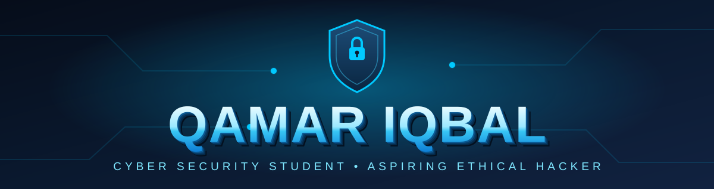

# Qamar Iqbal — Cyber Security Student & Aspiring Ethical Hacker

### 👋 About Me

**Cyber Security student teaching the internet to stay safe — one strong habit at a time.**

I'm **Qamar Iqbal**, a **Cyber Security student at COMSATS University Islamabad**, from **Gilgit-Baltistan, Pakistan** 🇵🇰. I'm training to become an **ethical hacker** — learning how attacks work so I can help people and organisations stop them.

- 🎓 Studying **Cyber Security**, focused on **Information Security, Network Security and AI Security**
- 🛡️ Building small, practical security tools in **Python** as I learn — see my featured projects below
- 📰 Sharing **one practical cyber security tip every day** on [LinkedIn](https://www.linkedin.com/in/qamar-iqbal-chalti/)
- 🌱 Deepening my skills in **network defence, ethical hacking methodology and secure system design**
- 🎯 Goal: become a security professional who makes the digital world safer for everyday users

> *"Attackers rarely break in anymore — they simply log in. My mission is to close that door, one strong habit at a time."*

### 🛡️ My Security Focus

### 💻 Languages & Tools

### 🚀 Featured Projects

| Project | What it does | Tech |
|---|---|---|
| 🔐 [**Password Strength Checker**](https://github.com/qamariqbalchalti/password-strength-checker) | Scores any password 0–100, estimates entropy and crack time, detects common/leaked passwords and bad patterns, and gives plain-language tips to fix them | Python |
| 🛡️ [**PyPort Scanner**](https://github.com/qamariqbalchalti/pyport-scanner) | Beginner-friendly multi-threaded TCP port scanner for learning how networks expose services — with a clear ethical-use guide for defenders | Python |
| 🎬 [**Movie Management System**](https://github.com/qamariqbalchalti/Movie-Management-System) | CineStar movie booking system — browsing, ticket booking and admin/customer management with a database back end | Java · MongoDB |
| 🚌 [**Tour Management System — QR Tours**](https://github.com/qamariqbalchalti/Tour-Managment-System-QR-Tours-) | Tour package and booking management with a Swing GUI, file-based persistence and full OOP design | Java |

### 📊 GitHub Analytics

### 📚 Right Now

- 📖 **Studying:** Cyber Security degree coursework at COMSATS University Islamabad
- 🐍 **Building:** small Python security tools to turn theory into practice
- ✍️ **Writing:** a daily cyber security tip series on LinkedIn — join me there and secure one habit a day

### 🤝 Connect With Me

**🎬 My YouTube channels**

*Thanks for stopping by — stay safe out there.* 🔐

